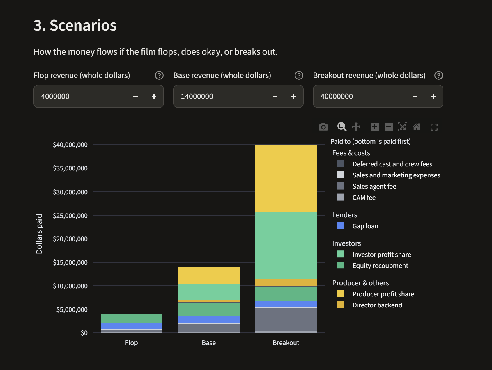

# CineVest


**See who gets paid back from an independent film, in what order, and how much, before the deal is signed.**

**Live app:** https://cinevest.streamlit.app



## The problem

Independent films are funded by stacking several sources: presales, state tax credits, gap loans and equity. Each gets paid back in a strict contractual order called the **recoupment waterfall**. First-time producers usually model this in fragile spreadsheets, and their investors can't easily check the math. Existing tools focus on tracking money *after* a film is released. CineVest helps producers plan and explain a deal *before* it closes.

## What it does

- **Capital stack:** enter presales, a gap loan and equity, and see whether the budget is covered. State tax credits (Indiana, Georgia, New Mexico) are calculated with real rates and caps, and transferable credits are counted at their cash value after the broker discount.
- **Editable waterfall:** fees, fixed costs, loans with interest, equity with a premium and profit splits, in any order.
- **Scenarios:** flop, base and breakout side by side, with a stacked chart coloured by role (fees, lenders, investors, producer).
- **Investor returns:** MOIC per scenario and the breakeven revenue at which equity is made whole.
- **Excel export** with live formulas, so anyone can audit the numbers.
- **Save and open deals** as files, with uploaded files validated before use.
- **Three demo films** ($150K, $1M, $8M) to explore.

## How it's built

The project separates the **math** from the **screens**:

| Part | What it does | Tech |
| --- | --- | --- |
| `engine/` | Waterfall, pari passu splits, IRR, MOIC, breakeven, tax incentives, deal validation. Pure Python, no UI | Python, dataclasses |
| `tests/` | 66 tests, including a property-based test that generates 1,000 random deals per run to prove money is never created or lost | pytest, Hypothesis |
| `app.py` | The web interface. It calls the engine and does no math itself | Streamlit, Plotly, pandas |
| `export.py` | Excel workbook with live `SUM` and MOIC formulas | openpyxl |
| `.github/workflows/` | Runs every test on every push | GitHub Actions |

**Engineering choices worth noting:**
- **Money is stored in integer cents** to avoid floating-point rounding errors.
- **Every engine result was first worked out by hand in Excel** (`demos/reference_deal.xlsx`) and is checked by a test.
- **IRR and breakeven are found by bisection** (binary search), written from scratch and matched against Excel's `=IRR()` and Goal Seek.
- **Pari passu splits round down, with the remainder going to the last party**, so shares always add up to exactly the amount paid.

## Run it locally

```
git clone https://github.com/yashh-re/CineVest.git
cd CineVest
python -m venv .venv
.venv\Scripts\activate        # Windows
source .venv/bin/activate     # Mac / Linux
pip install -r requirements.txt
streamlit run app.py
```

Run the tests with `python -m pytest`.

## Disclaimer

CineVest produces illustrative scenarios only. It is not legal or investment advice. Tax credit rules change; each preset lists its source and an as-of date. Check with the state film office before relying on them.

## Author

Built by Yashna Pandugala | Finance and Informatics @ IU 